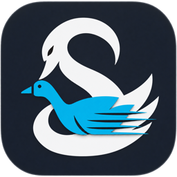

# Gooswan

<p align="center">
  
</p>

A WonderSwan / WonderSwan Color emulator for macOS, Windows and Linux, written in [Goose](https://github.com/aardappel/goose). Supports keyboard/gamepad controls, vertical games, save states and display scaling.

<p align="center">
  <a href="https://github.com/bubio/Gooswan/releases/latest">
    
  </a>
  <a href="https://github.com/bubio/Gooswan/releases/latest">
    
  </a>
  <a href="https://github.com/bubio/Gooswan/actions/workflows/ci.yml">
    
  </a>
</p>

## Download and play

Download your platform's ZIP from [**Releases**](https://github.com/bubio/Gooswan/releases/latest) and extract it.

| Platform | ZIP | Launch |
|----------|-----|--------|
| macOS (Apple Silicon) | `gooswan-macos-arm64.zip` | Move `Gooswan.app` to Applications and open it |
| macOS (Intel) | `gooswan-macos-x86_64.zip` | Move `Gooswan.app` to Applications and open it |
| Windows (x64) | `gooswan-windows-x86_64.zip` | Open `Gooswan/Gooswan.exe` |
| Linux (x64, Ubuntu 22.04 or newer) | `gooswan-linux-amd64.zip` | Run `Gooswan/gooswan`, or `sh Gooswan/install.sh` to add it to your application menu |

Keep the extracted files together. SDL3 is included; no separate installation is needed. ROMs and BIOS images are not included; a BIOS is optional.

The macOS app is not notarized. If Gatekeeper blocks a trusted download:

```bash
xattr -dr com.apple.quarantine /Applications/Gooswan.app
```

## Build from source and play

Download the source ZIP or clone this repository. You need a C compiler (Xcode Command Line Tools on macOS, GCC/Clang on Linux, or Visual Studio with C++ tools on Windows), `curl`, `tar`/`unzip`, and `shasum`/`sha256sum`. On Windows, run the commands in Git Bash.

From the project directory:

```bash
sh scripts/build.sh
./app/gooswan                 # Windows: ./app/gooswan.exe
```

The build downloads and verifies the pinned Goose compiler (`v2026.4`), including SDL3. No global Goose or SDL3 installation is required. To create a macOS `.app` or a distribution ZIP, see the [build and packaging guide](docs/development.md#packaging).

## Play

Open a `.ws` or `.wsc` ROM with **File > Open ROM** (`Ctrl+O`, or `Command+O` on macOS).

| Control | Default key |
|---------|-------------|
| X-pad | Arrow keys |
| Y-pad | W / A / S / D |
| A / B | X / Z |
| Start | Enter |

Gamepad defaults: D-pad = X-pad, South = B, East = A, Start = Start. Remap controls in **Settings > Input**. The menus provide save/load state, pause/reset, fullscreen (`F11`), scaling and rotation.

Cartridge saves are stored beside the ROM; keep ROMs in a writable folder. See the [user guide](docs/user-guide.md) for settings, BIOS, save locations and shortcuts. [Development details](docs/development.md) cover tests, accuracy and architecture.
